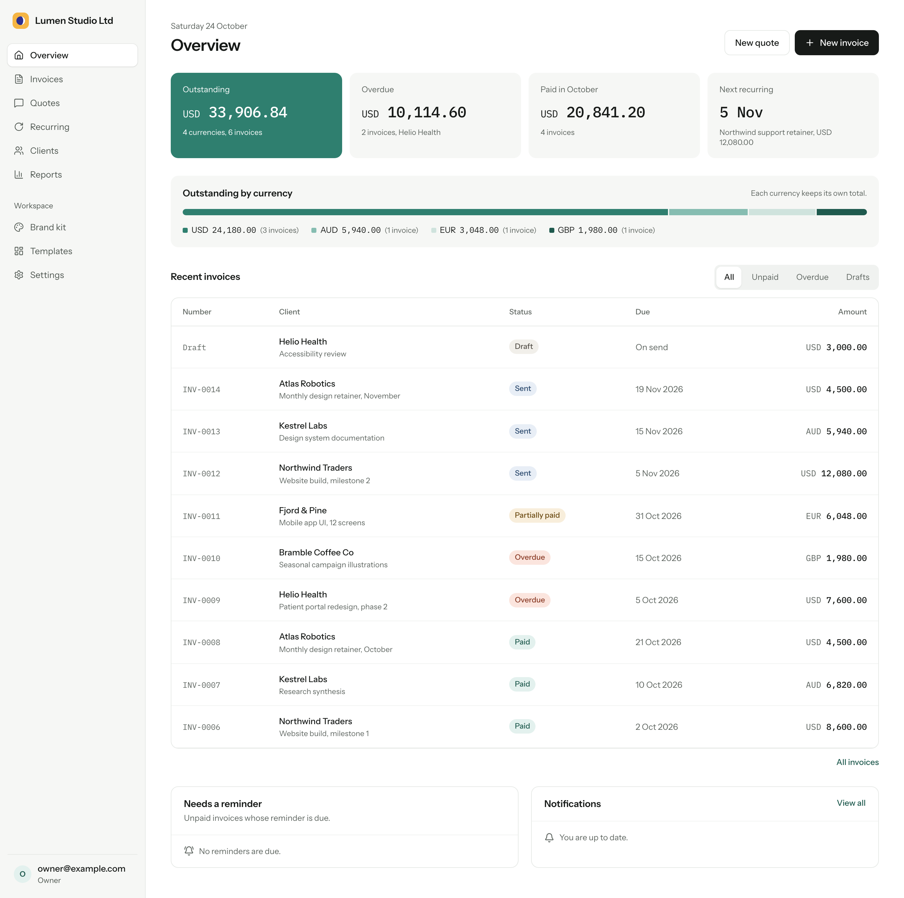
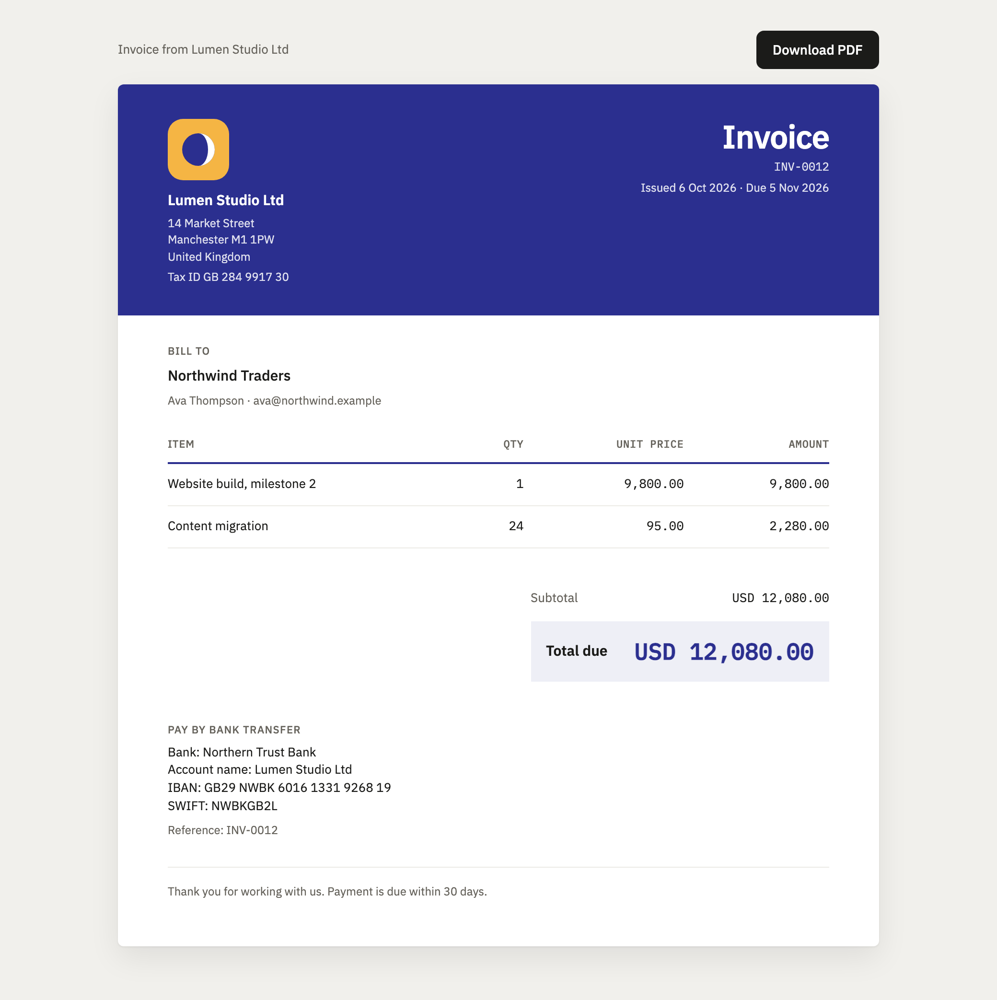
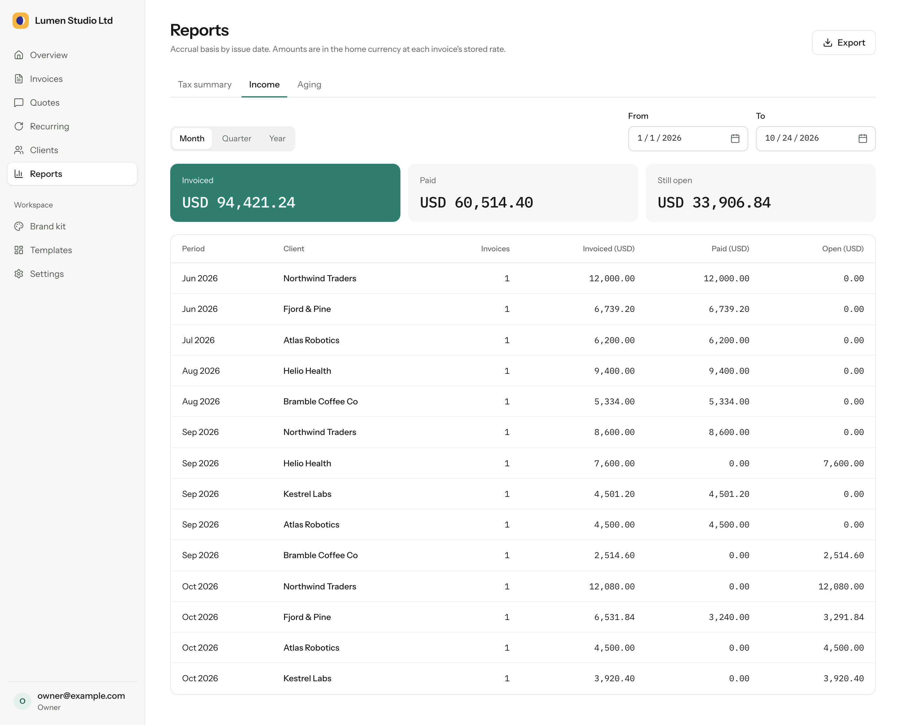
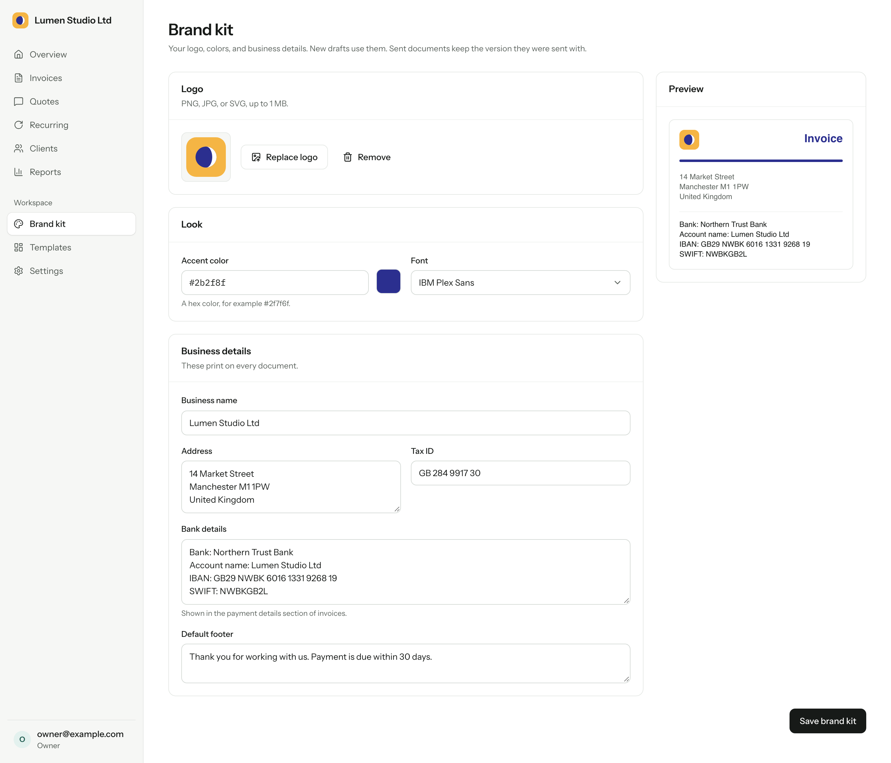

<h1>
  <picture>
    <source media="(prefers-color-scheme: dark)" srcset="brand/logos/plainbooks-dark.svg">
    
  </picture>
</h1>

[](LICENSE)

PlainBooks is a private invoicing app for one agency or freelancer. You send quotes and invoices, record payments, and see what clients owe you. It runs as one Cloudflare Worker on the free plans of Cloudflare and Resend. You do not need a server, a container, or a paid database.



## Why PlainBooks

- **It costs nothing to run.** The Workers Free plan, the Zero Trust Free plan, and the Resend free plan cover a small agency. The expected use is fewer than 100 invoices per month and fewer than 10 users.
- **You deploy it in one step.** Run `pnpm run ship`. The first deploy creates the database and the file bucket for you.
- **There is little to manage.** The app has one Worker, one D1 database, one R2 bucket, and one cron trigger. There are no servers to patch and no background workers to watch.
- **Your data stays in your account.** Clients, documents, and PDFs are in your own Cloudflare account. You can export the database to a SQL file with one command.
- **Clients need no account.** A client opens a quote or an invoice through a private link. They can accept or decline a quote on that page.

## Features

### Quotes and invoices

- Create quotes and invoices with line items, tax rates, discounts, notes, and custom fields.
- Send them by email, or mark them as sent if you deliver them another way.
- Let the client accept or decline a quote on a public page. Convert an accepted quote to an invoice with one click.
- Use gap-free numbers with your own prefix, for example `INV-0001`.
- Revise a sent document. The app keeps each revision and its PDF.
- Download a PDF of each revision. The app stores each PDF in R2 so it builds only once.
- Void an invoice, or reset its public link if the link was shared by mistake.



### Payments and money

- Record full or partial payments, and write off the remainder.
- Bill each client in their own currency. Each document stores its exchange rate to your home currency on the day you send it. You can also enter the rate by hand.
- See the totals in each currency and the totals in your home currency side by side.

### Automation

- Create recurring invoices from any invoice. The app makes a draft for you to check, or sends it automatically.
- Set payment reminders. The app suggests them on the overview page, or sends them on a schedule that you choose.
- Get notifications when a client accepts or declines a quote, when a recurring draft is ready, and when an email bounces.

### Reports

- Read a tax summary, an income report, and an aging report for any date range.
- Group the results by month, quarter, or year.
- Export each report to CSV.



### Brand and team

- Set your logo, colors, and font in the brand kit.
- Choose from three document layouts, or change a template in the template editor.
- Add team members as Owners or Members. Sign-in goes through Cloudflare Access, so the app stores no passwords.



## Tech stack

The stack is small on purpose. One language (TypeScript) runs on the server and in the browser, and one platform (Cloudflare) hosts everything.

| Part | What it uses |
| --- | --- |
| Hosting | One Cloudflare Worker. It serves the API, the web app, and the public document pages. |
| Database | Cloudflare D1 (SQLite), with Drizzle ORM. |
| Files | Cloudflare R2 for logos and cached PDFs. |
| PDFs | Cloudflare Browser Run. |
| Scheduled work | One Cron Trigger every 15 minutes, for recurring invoices, reminders, and email sends. |
| Email | Resend, with webhooks for bounces and complaints. |
| Sign-in | Cloudflare Access (Zero Trust). |
| Server code | Hono. |
| Web app | React 19, TanStack Router and Query, React Aria Components, and Tailwind CSS 4. |
| Build | Vite with the Cloudflare Vite plugin. |
| Checks | TypeScript in strict mode, Biome, Vitest, Playwright, and axe. |

## Run it on your computer

You need Node.js 22.12 or later and pnpm.

```sh
pnpm install
cp .dev.vars.example .dev.vars
pnpm db:migrate
pnpm dev
```

Before the first `pnpm dev`, set these values in `.dev.vars`:

- `AUTH_SECRET`: a random value of 32 characters or more.
- `ENCRYPTION_KEY`: 32 random bytes as base64.
- `SETUP_TOKEN`: a random value of 32 characters or more.
- `APP_URL`: the URL that Vite prints, for example `http://localhost:5173`.

To make the three random values, run this command three times:

```sh
node -e "console.log(require('crypto').randomBytes(32).toString('base64'))"
```

Open the URL that Vite prints. The first visit opens the setup screen. Enter the setup token from `.dev.vars`, your name, your email, and a password. This creates the Owner and signs you in. You do this one time for each local database. After that, sign in with the email and password.

To use fake email, exchange rate, and PDF services, add `FAKE_EXTERNALS=1` to `.dev.vars`. Without it, the app calls the real services. Read [Local services](#local-services) for more details.

### Local services

`pnpm dev` sets `APP_ENV=development`. The build never does. In development, the Worker also accepts writes from the local origin, `localhost` or `127.0.0.1`.

Local email, exchange rates, and PDFs call the real services. To send real email, set up an email provider in **Settings** > **Email**. Browser Run Quick Actions do not run locally, so PDF downloads fail in `pnpm dev`. To use fakes for all three, add `FAKE_EXTERNALS=1` to `.dev.vars`. With this flag and no saved email provider, the app sends email through a fake provider. The Worker ignores this flag unless `APP_ENV` is `development`.

## Deploy

> **The first public release is in progress.** Sign-in is moving into the app, and email is moving to any provider you choose. The Deploy to Cloudflare button comes back when that work ships. Until then, the steps below describe the current development version.

Run `pnpm run ship` on your computer. The first run asks for your host and owner email, creates the D1 database and the R2 bucket, and deploys. Later runs only build, migrate, and deploy. Read [docs/setup.md](docs/setup.md) for each step.

On your computer, use `pnpm run ship`. `pnpm run deploy` is the build command for the button's copy, where Cloudflare fills in the real database ID. On your computer it fails, because `wrangler.jsonc` has a placeholder database ID. Do not use `pnpm deploy`. It is a built-in pnpm command and does not run either script.

## Manage it

| Task | How |
| --- | --- |
| Update the app | Pull the new version, then run `pnpm run ship`. If you used the button, push to your copy. Database migrations run as part of the deploy. |
| Back up the data | Run `pnpm wrangler d1 export plainbooks --remote --output=backup-$(date +%F).sql`. D1 Time Travel also keeps 7 days of history. |
| Add a team member | Add the email in **Settings** > **Team**, and add it to the Access policy. |
| Check the limits | Read [Free-tier limits](docs/setup.md#free-tier-limits). |
| Fix a problem | Read [Troubleshooting](docs/setup.md#troubleshooting). |

## Scripts

| Script | What it does |
| --- | --- |
| `pnpm dev` | Starts Vite and the Worker locally. |
| `pnpm build` | Builds the web app and the Worker into `dist/`. |
| `pnpm preview` | Serves the build locally. |
| `pnpm typecheck` | Runs the TypeScript compiler on all projects. |
| `pnpm lint` | Runs Biome checks. |
| `pnpm format` | Applies Biome fixes and formatting. |
| `pnpm test` | Runs the Worker and web unit tests with Vitest. |
| `pnpm test:perf` | Runs the render benchmark. |
| `pnpm e2e` | Runs the Playwright specs and the axe checks. |
| `pnpm e2e:db` | Resets the two end-to-end D1 databases and applies the migrations. |
| `pnpm db:generate` | Generates a migration from `src/worker/db/schema.ts`. |
| `pnpm db:migrate` | Applies the migrations to the local D1 database. |
| `pnpm cf-typegen` | Generates `worker-configuration.d.ts` from `wrangler.jsonc`. |
| `pnpm run ship` | Deploys from your computer. The first run creates the D1 database and the R2 bucket and asks for your host. |
| `pnpm run deploy` | Builds, applies the remote D1 migrations, and deploys with `wrangler.jsonc` as it is. The Deploy button uses it. |

## Testing

- `pnpm test` runs two Vitest projects. The `worker` project runs `test/**/*.test.ts` in the Workers runtime with the migrations applied. The `web` project runs `src/**/*.test.{ts,tsx}` in happy-dom. Tests stub Resend, Frankfurter, and Browser Run.
- `pnpm test:perf` runs the render benchmark. It is skipped in `pnpm test`.
- `pnpm e2e` runs the Playwright specs in `e2e/` in Chromium. Install the browser once with `pnpm exec playwright install chromium`.

The end-to-end run starts two `vite` servers with `E2E=1`. Each server has its own D1 database in `.wrangler/e2e`, fixed test secrets, and fake external services. `pnpm e2e:db` resets both databases before each run.

- Port 5197 runs `e2e/smoke.spec.ts`. Before the specs start, `e2e/global-setup.ts` creates the Owner through the setup API and saves the signed-in browser state. The smoke spec uses this state. It creates a client, sends a quote, accepts it on the public page, converts it, sends the invoice, records the payment, and checks the dashboard. It also runs axe on the dashboard, the invoice editor, and the public invoice page, and checks the public page at 390 px wide.
- Port 5198 runs `e2e/auth.spec.ts` on an empty database. It completes setup in the browser, signs out, signs in, invites a member, and accepts the invite.

`e2e/env.ts` holds the test values. If your `.dev.vars` sets `APP_ENV`, `APP_URL`, `FAKE_EXTERNALS`, `SETUP_TOKEN`, `AUTH_SECRET`, or `ENCRYPTION_KEY` to other values, the end-to-end server stops with an error. Values in `.dev.vars` override the test values. To run the tests, move your `.dev.vars` away for the run, or remove these lines from it.

## Project layout

```
src/
  shared/        Code for the Worker and the browser: money, dates, schemas, domain types.
  worker/        The Worker.
    app.ts       The Hono app and route mounts.
    index.ts     The fetch and scheduled handlers.
    externals.ts Picks the real or fake Resend, Frankfurter, and Browser Run adapters.
    auth/        Access JWT verification and roles.
    db/          The Drizzle schema and client.
    email/       Email templates.
    render/      The HTML document renderer for pages and PDFs.
    routes/      API, public, render, and webhook routes.
    services/    Domain logic: documents, payments, email, PDF, jobs, recurring, reminders.
  web/           The React app.
    components/  The app shell and UI primitives.
    features/    Pages and components per feature.
    routes/      TanStack Router file routes.
migrations/      D1 migrations.
test/            Worker tests and helpers.
e2e/             Playwright tests.
docs/            The setup guide and the README screenshots.
```

## Contributing

Bug reports, ideas, and pull requests are welcome. Read [CONTRIBUTING.md](CONTRIBUTING.md) before you open a pull request. It explains how to set up the project, which checks to run, and how to write commit messages.

To report a security problem, do not open a public issue. Use **Report a vulnerability** on the **Security** tab of the repository.

## License

PlainBooks is released under the [MIT License](LICENSE).
